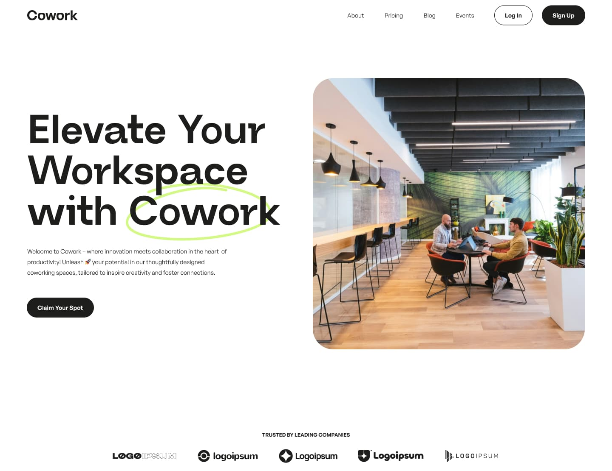

# Cowork — Coworking Space Landing Page

A responsive landing page for a fictional coworking company, hand-coded from a Figma design without a CSS or JS framework.

**Live demo:** [coworking-space-landing-page-v1.netlify.app](https://coworking-space-landing-page-v1.netlify.app/)



## Tech stack

- **Markup:** HTML, Nunjucks templates with JSON data
- **Styles:** Sass, BEM, CSS custom properties, PostCSS (Autoprefixer, cssnano)
- **Scripts:** vanilla JavaScript (ES modules), bundled with esbuild
- **Build:** gulp 5, BrowserSync, sharp for WebP, SVG sprite generation, WOFF2 font conversion

## Highlights

- **Fluid layout:** typography and spacing scale with `clamp()` between 390 and 1440 px, with a dedicated tablet layout.
- **FAQ accordion:** built on native `<details>` and `<summary>`. Keyboard support works without JavaScript, and the height animation is a progressive enhancement.
- **Testimonials:** a staggered grid on desktop and a native scroll-snap carousel on smaller screens, where swipe works without JavaScript and arrow buttons are added by it.
- **Partner logos:** a seamless CSS marquee that becomes a static list on desktop and with `prefers-reduced-motion`.
- **Video dialog:** a native `<dialog>` that creates the YouTube iframe on open and removes it on close, so nothing loads until it's needed and playback stops with the dialog.
- **Mobile menu:** `inert` on background content, focus restoration, Escape to close and a shared scroll lock.
- **Images:** `srcset` and `sizes`, WebP, lazy loading below the fold and reserved dimensions to prevent layout shift.

## Lighthouse

| Performance | Accessibility | Best Practices | SEO |
| :---------: | :-----------: | :------------: | :-: |
|     98      |      100      |      100       | 100 |

Mobile preset, measured on the deployed site.

## Getting started

Developed with Node.js 26.

```bash
npm install
npm start       # development server with live reload
npm run build   # production build in build/
```

To preview a production build, serve `build/` over HTTP. Opening `index.html` directly won't work because asset paths are root-relative.

## Project structure

```text
src/
├── html/       # pages, _layouts, _parts, _sections, _data (JSON)
├── css/        # abstracts, base, components, layout, sections
├── js/         # entry point and modules
├── icons/      # sources for the SVG sprite
├── img/        # interface images
├── uploads/    # content images
├── fonts/      # font sources
└── public/     # files copied to the site root, such as favicons
gulp/           # build tasks and configuration
```

## Notes

- This is a portfolio project: the company and its content are fictional.
- The newsletter form shows a confirmation message but doesn't send data anywhere.
- Links to pages outside this landing page are placeholders.

## Credits

Design: [Cowork — Coworking Space Company](https://www.figma.com/community/file/1354651678737219705/cowork-coworking-space-company) from the Figma Community. The design and images belong to their respective authors.
